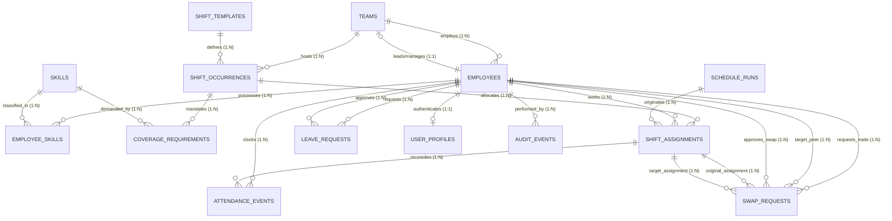

# Relational Schema and Entity-Relationship Architecture

**System**: Workforce Scheduling, Constraint Validation and Decision Traceability  
**Target RDBMS**: Supabase PostgreSQL 15+  
**Schema Version**: 2.0.0  

---

## 1. Entity-Relationship (ER) Diagram

---

## 2. Table Cardinalities & Relational Structure

| Source Entity | Target Entity | Cardinality | Relational Implementation | On Delete / Update |
| :--- | :--- | :--- | :--- | :--- |
| `teams` | `employees` | 1 : N | Foreign Key `employees.primary_team_id` -> `teams.team_id` | `RESTRICT` / `CASCADE` |
| `employees` | `teams` | 0..1 : 1 | Foreign Key `teams.manager_employee_id` -> `employees.employee_id` | `SET NULL` / `CASCADE` |
| `employees` | `skills` | N : M | Bridge Table `employee_skills` with `(employee_id, skill_id)` | `CASCADE` / `CASCADE` |
| `shift_templates` | `shift_occurrences` | 1 : N | Foreign Key `shift_occurrences.template_id` -> `shift_templates.template_id` | `RESTRICT` / `CASCADE` |
| `teams` | `shift_occurrences` | 1 : N | Foreign Key `shift_occurrences.team_id` -> `teams.team_id` | `RESTRICT` / `CASCADE` |
| `shift_occurrences` | `shift_assignments`| 1 : N | Foreign Key `shift_assignments.shift_id` -> `shift_occurrences.shift_id` | `CASCADE` / `CASCADE` |
| `employees` | `shift_assignments`| 1 : N | Foreign Key `shift_assignments.employee_id` -> `employees.employee_id` | `RESTRICT` / `CASCADE` |
| `schedule_runs` | `shift_assignments`| 1 : N | Foreign Key `shift_assignments.schedule_run_id` -> `schedule_runs.run_id` | `SET NULL` / `CASCADE` |
| `shift_occurrences` | `coverage_requirements`| 1 : N | Foreign Key `coverage_requirements.shift_id` -> `shift_occurrences.shift_id` | `CASCADE` / `CASCADE` |
| `skills` | `coverage_requirements`| 0..1 : N | Foreign Key `coverage_requirements.required_skill_id` -> `skills.skill_id` | `RESTRICT` / `CASCADE` |
| `employees` | `leave_requests` | 1 : N | Foreign Key `leave_requests.employee_id` -> `employees.employee_id` | `RESTRICT` / `CASCADE` |
| `employees` | `attendance_events`| 1 : N | Foreign Key `attendance_events.employee_id` -> `employees.employee_id` | `RESTRICT` / `CASCADE` |
| `shift_assignments`| `attendance_events`| 0..1 : N | Foreign Key `attendance_events.assignment_id` -> `shift_assignments.assignment_id` | `SET NULL` / `CASCADE` |
| `employees` | `swap_requests` | 1 : N | Foreign Key `swap_requests.requesting_employee_id` -> `employees.employee_id` | `RESTRICT` / `CASCADE` |
| `employees` | `user_profiles` | 1 : 1 | Foreign Key `user_profiles.employee_id` -> `employees.employee_id` (Unique) | `CASCADE` / `CASCADE` |

---

## 3. Integrity Constraints and Database Rules

1. **Foreign Key Integrity**:
   - Every dependent record strictly references an existing parent record.
   - Deletions of parent master records (e.g., Employees, Teams) are restricted if referenced by active shift occurrences or assignments.
2. **Double-Booking Prevention (Hard Constraint)**:
   - In baseline operations, an employee cannot have two shift assignments whose intervals `[start_datetime, end_datetime)` overlap.
3. **Approved Leave Collision Prevention**:
   - In baseline operations, an employee cannot be assigned to a shift occurrence that falls between the `start_date` and `end_date` of an `APPROVED` leave request.
4. **IT-Only Skill Constraint**:
   - Skills table is populated exclusively with validated IT domains across the 7 established technical pillars.
5. **Overtime Thresholds**:
   - Contractual maximum standard hours: 40 hours per rolling 7 days.
   - Cap on overtime: 8 hours per week (Maximum 48 hours).
6. **Swap Workflow Progression**:
   - State transition graph: `PENDING_PEER` -> `PENDING_MANAGER` -> `APPROVED` -> `APPLIED`.
   - Applying an unapproved swap directly violates state lifecycle integrity.
